# Architektura i przepływ danych

Mylik, zespół Iteracja7. _Mapa to nie terytorium. Mylik sprawdza mapę, zanim w nią uwierzysz._

## Zasada

Jeden proces Node, jeden port, jedna baza SQLite. Jeden silnik `engine.verify(input)` (`src/engine/pipeline.ts`). Kanały tylko przyjmują wejście i pokazują zapisany rekord. Nie mają własnej logiki sprawdzania.

## Przepływ

```mermaid
flowchart TD
  WWW["WWW: POST /api/verify, /api/verify/stream"] --> IN
  SMS["Adapter SMS (w prototypie: symulator): GET /sms, POST /sms/webhook"] --> IN
  DC["Adapter Discord: POST /discord/interactions<br/>(podpis Ed25519, odpowiedź odroczona, src/discord)"] --> IN
  IN["1. Wejście: walidacja, limit 2000 znaków (SMS 480), normalizacja<br/>src/input"] --> PII["2. Maskowanie danych osobowych<br/>PESEL, NIP, IBAN, karta, telefon, e-mail, dowód, IP<br/>(bez imion i nazwisk, bez kwot: wskazanie mentora)"]
  PII --> URL{"URL?"}
  URL -- tak --> FETCH["Pobranie strony: ochrona SSRF, tylko HTML/tekst,<br/>ukryta treść wycięta (src/engine/fetch)"]
  URL -- nie --> KEY
  FETCH --> KEY["3. Klucz rekordu (treść + wersja korpusu)<br/>jest już rekord? zwróć go bez modelu"]
  KEY --> INJ["4. Filtr poleceń (prompt injection) w kodzie<br/>src/engine/injection.ts"]
  INJ --> EXT["5. Wyodrębnienie twierdzeń, do 5 (model)<br/>+ słowa do wyszukiwania, temat"]
  EXT --> SEARCH["6. Wyszukiwanie FTS5 w korpusie (src/corpus)<br/>zapytania 'za' i 'przeciw', pula do 30 fragmentów<br/>(także weryfikacje redakcji w zbiorze)"]
  EXT --> FC["6'. Indeks weryfikacji (Google Fact Check Tools, src/factcheck)<br/>równolegle, krótkie frazy, własny limit 6 s"]
  FC --> FCA["ocena relacji tezy (model) + zgodność zdarzenia (kod)<br/>+ tabela ocen redakcji (kod)"]
  FCA --> RULES
  SEARCH --> RANK["7. Wybór do 10 kandydatów (model, tani)"]
  RANK --> ASSESS["8. Ocena stanowisk fragmentów (model)"]
  ASSESS --> CIT["9. Bramka cytatów (kod): cytat = dosłowny podciąg fragmentu"]
  CIT --> GATE["10. Bramka wsparcia (model, każdy cytat osobno)<br/>Haiku albo Basal albo Jev (opcje)"]
  GATE --> LIVE{"LIVE_LAYER=on i brak<br/>rozstrzygającego dowodu?"}
  LIVE -- tak --> L2["Druga warstwa: szukanie na zamkniętej liście serwisów<br/>(eksperymentalna, src/live)"]
  LIVE -- nie --> RULES
  L2 --> RULES["11. Reguły (kod, src/engine/rules.ts):<br/>etykieta i siła podstawy"]
  RULES --> ANS["Forma odpowiedzi (src/render/answer.ts):<br/>Tak. / Nie. / Częściowo. / Nie udało mi się tego potwierdzić.<br/>przypisanie oceny redakcji, link, brakujący dokument"]
  ANS --> NOTE["Ostrzeżenia neutralne: znane operacje (EUvsDisinfo), incydenty<br/>nigdy podstawa etykiety"]
  NOTE --> REC["12. Rekord w SQLite (retencja 30 dni)<br/>/r/&lt;id&gt;, karta SVG"]
  REC --> OUTW["WWW: pełny wynik, cytaty, źródła"]
  REC --> OUTS["SMS: krótka odpowiedź do 320 znaków + odsyłacz /r/&lt;id&gt;"]
  REC --> OUTD["Discord: ta sama krótka odpowiedź (do 2000 znaków), wiadomość uzupełniana webhookiem interakcji"]
```



Ten sam przepływ w skrócie tekstowym:

```
WWW / adapter SMS (w prototypie: symulator) / adapter Discord
  -> wejście i maskowanie (kod) -> [URL: bezpieczne pobranie strony]
  -> klucz rekordu (powtórka = zapisany wynik)
  -> filtr poleceń (kod) -> twierdzenia (model)
  -> wyszukiwanie w korpusie (kod) -> kandydaci (model) -> ocena (model)
  -> bramka cytatów (kod) -> bramka wsparcia (model)
  -> [druga warstwa, domyślnie wyłączona]
  -> reguły: etykieta i siła (kod) -> rekord -> odpowiedź w kanale
```

## Oceny redakcji i forma odpowiedzi (zad. 40)

- Warstwa 3 źródeł: oceny redakcji sprawdzających fakty, ze zbioru (nasze wyszukiwanie) i z indeksu Google Fact Check Tools (pomocniczo, równolegle). Ocena redakcji przechodzi przez jawną tabelę w kodzie i jest zawsze przypisana redakcji. Szczegóły i zachowanie przy awarii: [ZRODLA.md](ZRODLA.md), warstwa 3.
- Awaria indeksu, gdy zbiór nie rozstrzyga: stan techniczny z komunikatem o niedostępnym indeksie (scenariusz J), nigdy „nie znaleziono”.
- Pytanie rozstrzygające („Czy…?”) dostaje na początku bezpośrednią odpowiedź z szablonu (`directAnswer`), potem zdanie relacjonujące źródło z datą, potem link. Przy braku dowodów: czego nie potwierdzono, jaki rodzaj dokumentu by to rozstrzygnął (`neededDocument`, ogólny szablon wg rodzaju sprawy) i że brak wyniku nie oznacza nieprawdy. Ta sama treść w WWW (`buildHeadline`) i SMS (`renderShortAnswer`, skrót z adresem publikacji, gdy się mieści).

## Adapter Discord (trzeci adapter)

`POST /discord/interactions` (`src/discord`) to cienka warstwa na tym samym `engine.verify`, bez nowej logiki werdyktu. Przebieg: (1) podpis Ed25519 z nagłówków `X-Signature-Ed25519` i `X-Signature-Timestamp` liczony na surowych bajtach ciała, `node:crypto`, bez nowych zależności; zły lub brakujący podpis: 401; (2) PING: PONG; (3) `/sprawdz` albo polecenie z menu wiadomości: walidacja (niepusty tekst, do 2000 znaków), limit zgłoszeń na użytkownika, potem natychmiastowa odpowiedź „odroczona” (typ 5, ephemeral, chyba że `publicznie`); (4) po odesłaniu odpowiedzi HTTP (`setImmediate`) proces dokańcza pracę: `engine.verify`, potem `PATCH /webhooks/<application_id>/<token>/messages/@original` z wynikiem. Pod Passengerem proces Node jest stały, więc praca po odpowiedzi HTTP jest dokańczana (żądanie nie wisi); własny limit pracy to 60 s (`DISCORD_WORK_TIMEOUT_MS`, silnik ma swoje 22 s), a po nim i przy każdym błędzie wiadomość dostaje komunikat techniczny, nigdy ciszę. Token interakcji ważny jest 15 minut.

Treść odpowiedzi to wyłącznie `record.shortAnswer` z `src/render` (zdanie wyniku, etykieta, cytat ze źródłem i datą, „Stan na”, odsyłacz `/r/<id>` na `PUBLIC_BASE_URL`) albo komunikat stanu z silnika; adapter nie składa własnych sformułowań werdyktu. Kanał nie jest częścią klucza rekordu, więc WWW, SMS i Discord dzielą rekordy (test `tests/engine/channels.test.ts`). Uwaga o kontrakcie: `Channel` w `src/contracts` zna tylko `www` i `sms`, więc do silnika Discord przekazuje się jako `sms` (stała `DISCORD_ENGINE_CHANNEL` przełączy się na `discord`, gdy kontrakt go doda); własne zdarzenia adaptera trafiają do tabeli `events` z kanałem `discord`.

## Pętla informacji (scenariusz H)

Serwer opakowuje silnik (`src/cases`). Po otrzymaniu rekordu z co najmniej jednym twierdzeniem „brak wystarczających dowodów” zapisuje lub aktualizuje **sprawę** w osobnych tabelach `cases` i `case_records` (deduplikacja: znormalizowany tekst plus podobieństwo słów kluczowych). Urzędnik widzi sprawy pod `/urzednik` (token z konfiguracji, bez tokenu 401), a obywatel przy takim wyniku jedno zdanie: „zapisano” albo, po oznaczeniu przez urzędnika, „przekazano”. Nic nie jest wysyłane (e-mail to tylko przygotowane miejsce). Silnik o sprawach nie wie. Opis: [PETLA_INFORMACJI.md](PETLA_INFORMACJI.md).

## Co robi kod, a co model

| Krok | Kto |
|---|---|
| maskowanie, filtr poleceń, wyszukiwanie, bramka cytatów, etykieta, siła, zdania dla obywatela (szablony) | kod |
| wyodrębnienie twierdzeń, wybór kandydatów, ocena stanowiska fragmentu, bramka wsparcia | model (wyjście tylko według schematu) |

Model nie widzi adresów ani metadanych źródeł, tylko identyfikator i treść fragmentu. Etykieta nigdy nie zależy od domeny, autora ani rodzaju źródła. Rodzaj źródła wpływa tylko na siłę podstawy.

## Wygląd wyniku: rola na żywo

Rola postaci (12 ról, w tym komentator i piłkarz) i flaga "temat poważny" nie należą do silnika: wybiera je kod w `src/roles` po słowach z jednego pliku (`src/roles/live-words.ts`), zapisuje przy rekordzie (tabela `record_roles`) i dokłada do odpowiedzi API jako pole `appearance` (`withLiveRole` w `src/roles/track.ts`). Rola nigdy nie zmienia werdyktu, siły podstawy ani treści. Opis i zasady: [ROLE_NA_ZYWO.md](ROLE_NA_ZYWO.md).

## Stany techniczne

Brak klucza, limit API, błąd, przekroczony czas (22 s, `DEFAULT_DEADLINE_MS`), strona niedostępna: zawsze stan (`awaria_techniczna`, `brak_mozliwosci_sprawdzenia`, `potrzeba_doprecyzowania`), nigdy etykieta.

## Gdzie szukać w kodzie

`src/input` wejście i maskowanie, `src/engine` potok i reguły, `src/llm` dostawcy modelu, `src/corpus` korpus, `src/live` druga warstwa, `src/server` WWW i API, `src/sms` adapter SMS, `src/discord` adapter Discord (trzeci adapter, ten sam `engine.verify` i ten sam rekord), `src/render` teksty dla obywatela, `src/security` limit żądań i retencja, `src/cases` sprawy urzędnika (pętla informacji), `src/server/clerk.ts` widok urzędnika, `src/obs` log i statystyki (`GET /api/stats`).

Zależności zewnętrzne i jak je wymienić: [ZALEZNOSCI.md](ZALEZNOSCI.md). Modele: [MODELE.md](MODELE.md).
