# Architektura i przepływ danych

Mylik, zespół Iteracja7. _Mapa to nie terytorium. Mylik sprawdza mapę, zanim w nią uwierzysz._

## Zasada

Jeden proces Node, jeden port, jedna baza SQLite. Jeden silnik `engine.verify(input)` (`src/engine/pipeline.ts`). Kanały tylko przyjmują wejście i pokazują zapisany rekord. Nie mają własnej logiki sprawdzania.

## Przepływ

```mermaid
flowchart TD
  WWW["WWW: POST /api/verify, /api/verify/stream"] --> IN
  SMS["Adapter SMS (w prototypie: symulator): GET /sms, POST /sms/webhook"] --> IN
  IN["1. Wejście: walidacja, limit 2000 znaków (SMS 480), normalizacja<br/>src/input"] --> PII["2. Maskowanie danych osobowych<br/>PESEL, NIP, IBAN, karta, telefon, e-mail, dowód, IP, imię i nazwisko po zwrotach typu 'Pan', 'Nazywam się'"]
  PII --> URL{"URL?"}
  URL -- tak --> FETCH["Pobranie strony: ochrona SSRF, tylko HTML/tekst,<br/>ukryta treść wycięta (src/engine/fetch)"]
  URL -- nie --> KEY
  FETCH --> KEY["3. Klucz rekordu (treść + wersja korpusu)<br/>jest już rekord? zwróć go bez modelu"]
  KEY --> INJ["4. Filtr poleceń (prompt injection) w kodzie<br/>src/engine/injection.ts"]
  INJ --> EXT["5. Wyodrębnienie twierdzeń, do 5 (model)<br/>+ słowa do wyszukiwania, temat"]
  EXT --> SEARCH["6. Wyszukiwanie FTS5 w korpusie (src/corpus)<br/>zapytania 'za' i 'przeciw', pula do 30 fragmentów"]
  SEARCH --> RANK["7. Wybór do 10 kandydatów (model, tani)"]
  RANK --> ASSESS["8. Ocena stanowisk fragmentów (model)"]
  ASSESS --> CIT["9. Bramka cytatów (kod): cytat = dosłowny podciąg fragmentu"]
  CIT --> GATE["10. Bramka wsparcia (model, każdy cytat osobno)<br/>Haiku albo Basal (opcja)"]
  GATE --> LIVE{"LIVE_LAYER=on i brak<br/>rozstrzygającego dowodu?"}
  LIVE -- tak --> L2["Druga warstwa: szukanie na zamkniętej liście serwisów<br/>(eksperymentalna, src/live)"]
  LIVE -- nie --> RULES
  L2 --> RULES["11. Reguły (kod, src/engine/rules.ts):<br/>etykieta i siła podstawy"]
  RULES --> NOTE["Ostrzeżenia neutralne: znane operacje (EUvsDisinfo), incydenty<br/>nigdy podstawa etykiety"]
  NOTE --> REC["12. Rekord w SQLite (retencja 30 dni)<br/>/r/&lt;id&gt;, karta SVG"]
  REC --> OUTW["WWW: pełny wynik, cytaty, źródła"]
  REC --> OUTS["SMS: krótka odpowiedź do 320 znaków + odsyłacz /r/&lt;id&gt;"]
```



Ten sam przepływ w skrócie tekstowym:

```
WWW / adapter SMS (w prototypie: symulator)
  -> wejście i maskowanie (kod) -> [URL: bezpieczne pobranie strony]
  -> klucz rekordu (powtórka = zapisany wynik)
  -> filtr poleceń (kod) -> twierdzenia (model)
  -> wyszukiwanie w korpusie (kod) -> kandydaci (model) -> ocena (model)
  -> bramka cytatów (kod) -> bramka wsparcia (model)
  -> [druga warstwa, domyślnie wyłączona]
  -> reguły: etykieta i siła (kod) -> rekord -> odpowiedź w kanale
```

## Co robi kod, a co model

| Krok | Kto |
|---|---|
| maskowanie, filtr poleceń, wyszukiwanie, bramka cytatów, etykieta, siła, zdania dla obywatela (szablony) | kod |
| wyodrębnienie twierdzeń, wybór kandydatów, ocena stanowiska fragmentu, bramka wsparcia | model (wyjście tylko według schematu) |

Model nie widzi adresów ani metadanych źródeł, tylko identyfikator i treść fragmentu. Etykieta nigdy nie zależy od domeny, autora ani rodzaju źródła. Rodzaj źródła wpływa tylko na siłę podstawy.

## Stany techniczne

Brak klucza, limit API, błąd, przekroczony czas (22 s, `DEFAULT_DEADLINE_MS`), strona niedostępna: zawsze stan (`awaria_techniczna`, `brak_mozliwosci_sprawdzenia`, `potrzeba_doprecyzowania`), nigdy etykieta.

## Gdzie szukać w kodzie

`src/input` wejście i maskowanie, `src/engine` potok i reguły, `src/llm` dostawcy modelu, `src/corpus` korpus, `src/live` druga warstwa, `src/server` WWW i API, `src/sms` adapter SMS, `src/render` teksty dla obywatela, `src/security` limit żądań i retencja, `src/obs` log i statystyki (`GET /api/stats`).

Zależności zewnętrzne i jak je wymienić: [ZALEZNOSCI.md](ZALEZNOSCI.md). Modele: [MODELE.md](MODELE.md).
